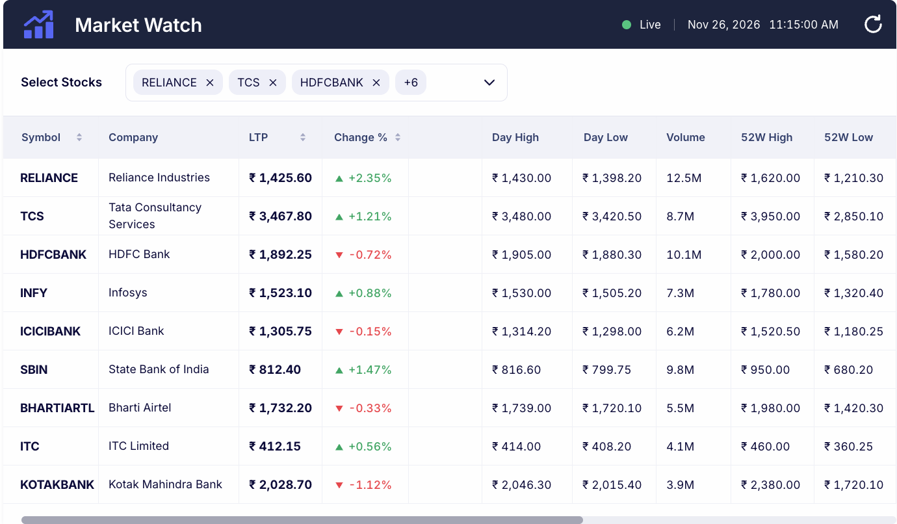

# Market Watch

A real-time stock table built with React, NestJS and WebSockets in TypeScript. Prices are simulated on the server, and no table library is used.



## Running it

Needs Node 20 or newer.

```bash
npm install
npm run dev        # http://localhost:5173
```

For production, run `npm run build && npm start`. Tests run with `npm test`, and settings are listed in `.env.example`.

## How it works

- The client subscribes to symbols over `/ws`, gets a full snapshot, then only the fields that change.
- I used plain `ws` instead of Socket.IO because the messages are simple.
- Each user receives only their own stocks, and slow clients don't hold up the others.
- Each cell subscribes to its own value with `useSyncExternalStore`, so only changed cells re-render.

In local load tests, up to 500 clients ran without dropped or wrong updates (`npm run load-test`).

## Assumptions

- Open, Prev. Close, Change ₹, Bid, Ask and Avg. Price are extra columns. The empty column in the reference design is left out.
- No mobile design was given, so phones get narrower columns and a bottom-sheet stock picker.

## Limitations

- Single server instance and no authentication.
- Rows are not virtualised.
- Not tested on a physical phone or in Safari.
