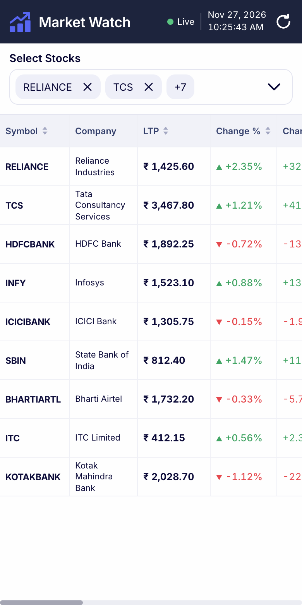

# Market Watch

Real-time stock market watch: **React + Vite** front end, **NestJS** back end, **WebSockets** for streaming, TypeScript throughout. The table is hand-built; no table or UI library is used.

All market data is **simulated**.

## Quick start

Requires Node.js 20 or newer (developed on Node 25).

```bash
npm install
npm run dev          # server on :3000, web app on http://localhost:5173
```

Production build, served by NestJS on one port:

```bash
npm run build
npm start            # http://127.0.0.1:3000
```

To open it from a phone on the same network:

```bash
npm run build && HOST=0.0.0.0 npm start    # then visit http://<your-computer-ip>:3000
```

| Command | Purpose |
|---|---|
| `npm test` | Server (Jest) and web (Vitest) tests |
| `npm run typecheck` / `npm run lint` | Static checks |
| `npm run load-test -- --clients 50` | Load test against a running server |

Add `?debug` to the URL to see render counts per second and an outline on every cell that re-renders.

## Deploy

[`render.yaml`](render.yaml) describes the service for [Render](https://render.com): in the dashboard choose **New → Blueprint** and select this repository. On any other Node host, build with `npm ci --include=dev && npm run build`, start with `npm start`, and set `HOST=0.0.0.0`. The host must allow WebSockets. Run a single instance.

## Configuration

Environment variables read by the server. Invalid values stop start-up with a clear message.

| Variable | Default | Meaning |
|---|---|---|
| `STOCK_COUNT` | 50 | Number of simulated stocks (up to 10,000; extra ones are named `SIM0051`…) |
| `TICK_MS` | 500 | Interval between price updates |
| `UPDATE_RATIO` | 0.5 | Share of stocks that trade on each tick |
| `VOLATILITY` | 0.0006 | Size of one price step |
| `MAX_SYMBOLS_PER_CLIENT` | 500 | Subscription limit per connection |
| `HIGH_WATER_BYTES` | 524288 | Unsent bytes at which a slow client is paused |
| `MAX_LAG_MS` | 10000 | How long a client may stay behind before being disconnected |
| `HEARTBEAT_MS` | 30000 | Dead-connection check interval |
| `HOST`, `PORT` | 127.0.0.1, 3000 | Listen address |

Front end: `VITE_WS_URL` overrides the WebSocket address; `SERVER_URL` changes the dev proxy target.

Example: `STOCK_COUNT=500 TICK_MS=100 npm start`

## Layout

```
apps/server/src     NestJS
  simulator/        price engine (pure) and its clock
  subscriptions/    symbol ↔ client index
  broadcast/        fan-out and slow-client handling
  gateway/          WebSocket lifecycle and message validation
  catalog/ health/  REST: /api/stocks, /api/health, /api/metrics
  config/           validated settings
apps/web/src        React
  store/            quotes with per-cell subscriptions
  transport/        socket, reconnect, per-frame batching
  components/       Header, StockSelect, MarketTable
  hooks/ utils/     selection, sorting, formatting
packages/shared     message and quote types used by both sides
tools/              load test
```

## Protocol

JSON over one WebSocket at `/ws`. Types live in [`packages/shared/src/protocol.ts`](packages/shared/src/protocol.ts).

| Direction | Message | Meaning |
|---|---|---|
| ← | `{"t":"hello","tickMs","maxSymbols","stocks"}` | Sent on connect |
| → | `{"t":"subscribe","symbols":[…]}` | Start watching |
| → | `{"t":"unsubscribe","symbols":[…]}` | Stop watching |
| ← | `{"t":"snapshot","ts","d":[[symbol,quote]]}` | Every field, after subscribe or resync |
| ← | `{"t":"tick","ts","d":[[symbol,changes]]}` | Changed fields only |
| → | `{"t":"resync"}` / `{"t":"ping"}` | Refresh button / keep-alive |
| ← | `{"t":"pong"}` / `{"t":"error","code","message"}` | |

## Design decisions

### Rendering only what changed
- Quotes live in a plain store outside React. Each cell subscribes to one `(symbol, field)` pair through `useSyncExternalStore`.
- A cell's snapshot is its **formatted text**, so a change too small to see (volume still `12.5M`) causes no render.
- Rows and the header are memoised. A price tick renders no row and no table.
- Incoming messages are merged and applied **once per animation frame**. In a background tab they keep merging, so memory stays bounded.
- `table-layout: fixed` means changing text never resizes columns. Sticky columns and header are pure CSS, and scrolling sets a DOM attribute without any React render.
- Proof: [`rendering.test.tsx`](apps/web/src/components/MarketTable/rendering.test.tsx) asserts exact render counts for ticks, adding a stock and removing one.

A state library or `React.memo` on rows alone was rejected: a store with per-key subscriptions does the job in about 50 lines and gives cell-level precision.

### Distributing data
- **Plain `ws`** rather than Socket.IO: smaller frames, no extra protocol; reconnection and subscriptions are simple to own.
- A two-way index (`symbol → clients`, `client → symbols`) means fan-out visits only interested clients, and one client's selection cannot affect another's.
- Each changed stock is **serialised once per tick** and the fragments are joined per client.
- Only changed fields are sent after the first snapshot.
- **Back-pressure:** a client whose send buffer exceeds the limit is skipped, then given a fresh snapshot when it drains. One that never drains is disconnected, so it cannot exhaust memory.
- Heartbeats remove dead connections. Messages are validated and size-limited.
- The client reconnects with exponential back-off and jitter, resubscribes, and marks prices as stale meanwhile.

### Correctness of the simulation
Prices are stored as whole paise on a ₹0.05 tick, follow a mean-reverting random walk inside a ±10% band, and keep `low ≤ price ≤ high`, 52-week bounds, rising volume, and change % consistent with the previous close.

## Concurrency results

`npm run load-test` connects many clients with different random selections, changes a fifth of them mid-run, and fails on any wrong-stock delivery, missing data or disconnect.

Measured on an Apple M4 Pro (12 cores, 24 GB), 20 s per scenario, load generator and server on the same machine over loopback. The latency is from the server tick to receipt by the test client; it excludes browser rendering and real network delay.

| Measure | A: 50 clients | B: 200 clients | C: 500 clients | D: stress |
|---|---|---|---|---|
| Clients connected | 50 | 200 | 500 | 50 |
| Stocks available | 50 | 50 | 50 | 500 |
| Subscriptions | 671 | 2509 | 6323 | 25000 |
| Tick messages per second | 100 | 398 | 995 | 495 |
| Stock updates per second | 663 | 2555 | 6180 | 247451 |
| Data sent | 0.06 MB/s | 0.24 MB/s | 0.58 MB/s | 22.03 MB/s |
| Latency p50 / p95 / p99 / max | 2 / 5 / 6 / 7 ms | 6 / 9 / 10 / 11 ms | 9 / 15 / 16 / 17 ms | 15 / 24 / 25 / 29 ms |
| Server CPU (one core = 100%) | 0.9% | 1.6% | 2.8% | 5.2% |
| Server memory (RSS) | 90.45 MB | 106.25 MB | 118.11 MB | 143.58 MB |
| Fan-out time per tick, average / max | 1.8 / 4.05 ms | 5.24 / 6.9 ms | 9.51 / 11.98 ms | 3.88 / 6.33 ms |
| Event-loop delay p99 | 1.34 ms | 4.11 ms | 8.27 ms | 4.66 ms |
| Ticks skipped for slow clients | 0 | 0 | 0 | 0 |
| Wrong-stock deliveries | 0 | 0 | 0 | 0 |
| Clients missing data | 0 | 0 | 0 | 0 |
| Unexpected disconnects | 0 | 0 | 0 | 0 |

Scenarios A–C: 50 stocks, a tick every 500 ms, 5–20 stocks per client. D: 50 clients each watching all 500 stocks, a tick every 100 ms, every stock changing (about 440 KB/s per client, far more than a phone screen needs).

To reproduce A:

```bash
npm run build && npm start            # terminal 1
npm run load-test -- --clients 50     # terminal 2
```

For D, start the server with `STOCK_COUNT=500 TICK_MS=100 UPDATE_RATIO=1` and run the test with `--clients 50 --min 500 --max 500`.

## Browser smoothness

Headless Chrome on the same machine, a tick every 100 ms, half the stocks changing, sampled for 6 s.

| Scenario | Frames per second (120 Hz) | 95th-percentile frame | Long tasks (>50 ms) |
|---|---|---|---|
| Desktop, 50 rows | 120 | 9 ms | 0 |
| Phone viewport, 50 rows, CPU throttled 4× | 120 | 9 ms | 0 |
| Desktop, 200 rows | 113 | 17 ms | 0 |
| Phone viewport, 200 rows, CPU throttled 4× | 92 | 33 ms | 0 |

Throttled desktop hardware is not a real phone; test on a device before relying on the mobile figures.

## Screenshots




## Assumptions and deviations from the reference

| Topic | Choice |
|---|---|
| Rows | The table shows exactly the selected stocks. The mock shows 5 selected but 9 rows, so the "+N" chip differs |
| Row height | Uniform 59 px; the mock's rows vary between about 53 and 71 px |
| Extra columns | Open, Prev. Close, Change ₹, Bid, Ask and Avg. Price were added after 52W Low, giving the horizontal scroll the mock's scrollbar implies |
| Blank column | The empty column after Change % is reproduced on tablet and desktop, and omitted on phones |
| Phones | No mobile design was supplied: narrower sticky columns, a two-line header clock and a bottom-sheet stock list |
| Very narrow screens | Below 375 px the header shows the time without the date |
| Sorting | Symbol, LTP and Change %: ascending, descending, then selection order. Live sorts re-order at most once a second |
| Clock | The viewer's local time |
| Font | Inter, bundled, as the closest match to the mock |
| Persistence | The selection is saved in `localStorage` |

## Limits and next steps

- **One server process.** To scale out, publish ticks to Redis pub/sub or NATS from a single simulator and run several gateway instances behind a load balancer.
- **No row virtualisation.** Cell updates stay cheap, but hundreds of rows make a large DOM, especially on phones. Windowing would be the next step.
- **No authentication, TLS or WebSocket origin check.** Add these (TLS at a reverse proxy) before exposing it publicly.
- JSON is used for readability; a binary encoding would reduce bandwidth further.
- Build tooling is pinned to NestJS 11, Vite 7 and TypeScript 5.9.
- `npm audit --omit=dev` reports no vulnerabilities; plain `npm audit` flags some development-only tools.
